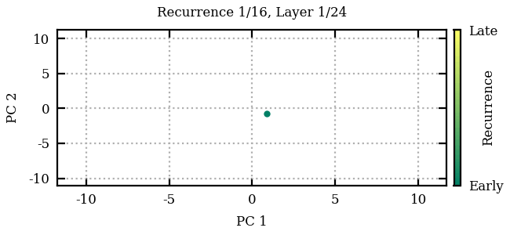

# looped-internals

Analyse the internal representations of looped transformers with TransformerLens.
Supported model integrations include Raven/Huginn and its retrofits, Ouro, Parcae
and its one-recurrence controls, a small configurable recurrent transformer,
Nanochat, and standard feedforward checkpoints.



The first 16 recurrences of a seeded, randomly initialised 24-layer transformer.
PCA is fitted to the final token's residuals across all 64 recurrences; each line
traces the layers within one recurrence.

## Install

```bash
uv sync --frozen --dev --group experiments
.venv/bin/python -m ipykernel install --prefix .venv \
    --name looped-internals --display-name 'Looped Internals'
```

Regenerate the animation with `.venv/bin/python splash_trajectory_gif.py`.
It runs locally without downloads and writes `docs/splash_trajectory.gif`.

The lockfile pins TransformerLens 3.9.0 and Transformers 5.17.0. Pretrained runs
download the corresponding public Hugging Face checkpoints and datasets.

`load_model` uses each Hugging Face checkpoint's published tokenizer defaults,
undoing TransformerLens's automatic BOS override. Ouro and Parcae omit BOS; checkpoints
whose tokenizers prepend it retain it. The [BOS comparison notebook](experiments/bos_comparison.ipynb)
explicitly tests both conditions and records the actual input tokens.

Parcae checkpoints load through the `parcae-lm` package rather than Transformers,
pinned to the [`parcae-stability`](https://github.com/HughBlayney/parcae-stability)
training fork because the stability sweep's configs use fields upstream does not
define. The released models come from SandyResearch; the recurrence-ablated
controls (`blayney/parcae-*-rec1`) and the injection-stability sweep
(`blayney/parcae-stability-sweep`) are exported from their training runs into the
same two-file layout and published under `PARCAE_MODELS_ORG` (default `blayney`).
A local export directory still loads by passing an explicit
`ParcaeCheckpoint("/path/to/export")` (see `src/looped_internals/models/parcae.py`).

## Layers and virtual layers

A **layer** is a distinct set of transformer-block weights. A **virtual layer**
is one application of a layer during a forward pass. Two recurrent layers
applied for three recurrences give two layers and six virtual layers:

| Virtual layer index | 0 | 1 | 2 | 3 | 4 | 5 |
| --- | --- | --- | --- | --- | --- | --- |
| Layer index | 0 | 1 | 0 | 1 | 0 | 1 |
| Recurrence | 0 | 0 | 1 | 1 | 2 | 2 |

Distinct parameter sets are separate layers even when their values happen to
match. In a feedforward model, each layer has one virtual layer. Prelude and
coda layers likewise contribute one virtual layer each.

`ModelLayerStructure` describes the `LayerGroup` objects, and
`structure.virtual_layers(n_recurrences)` enumerates `VirtualLayer` records.
Native model attributes and TransformerLens hook paths such as `blocks.0`
retain their upstream names.

An **attention pattern** is the realised post-softmax matrix of attention
probabilities from queries to keys for one head and one layer application.
We use **weights** for learned parameters, including the Q/K/V projection
matrices. Attention-pattern metrics use names such as
`compute_pairwise_attn_pattern_diff_norm` and `ModelRunData.pairwise_attn_pattern_diff_norm`.

## One workflow: cache, reduce, release

```python
import torch
import matplotlib.pyplot as plt
from looped_internals.models import load_model
from looped_internals.capture import compute_model_run_data, metrics_names_filter

model, structure = load_model("ouro_1_4b", num_steps=4, device="cuda")
tokens = model.tokenizer.encode("The cat sat on the mat.", return_tensors="pt").to("cuda")

with torch.no_grad():
    _, cache = model.run_with_cache(
        tokens, accumulate=True, names_filter=metrics_names_filter, device="cpu"
    )
run = compute_model_run_data(cache, tokens, structure, compute_pairwise=False)[0]
del cache

# Each row is a virtual layer; columns are attention heads.
plt.plot(run.get_metric("sink_scores").mean(-1).numpy())
plt.xlabel("Virtual layer")
plt.ylabel("Mean attention to the first token")
```

`ModelRunData` is the compact result of a forward pass, one object per batch
example. Its `per_virtual_layer_metrics` list contains one
`PerVirtualLayerMetrics` record per virtual layer, with a `layer_index` identifying
the weights and a `virtual_layer_index` identifying the application.
`get_metric(..., group_by="layer")` groups virtual layers that share weights;
`group_by="recurrence"` groups the core by cycle, with prelude/coda where present.
For aggregation, `scale_by="virtual_layer"` scales the virtual layer index to
0–100%, while `scale_by="layer"` scales the layer index.

Extraction reads cached tensors individually. It never stacks a second copy of
the full residual or attention history. Results are CPU tensors, and saving
results does not deep-copy them. The cache itself still holds the selected raw
activations until released. This deliberately keeps a single collection model.

### What to retain

| Measurement | Selection |
| --- | --- |
| Sink scores/rates, mixing, attention concentration, first-token residual norm | Always reduced from available hooks |
| Pairwise residual cosine similarity and difference norm; attention-pattern difference norm | `compute_pairwise=True` (default); quadratic summary size |
| Comparisons to final observed states and between successive recurrences | `compute_differences=True` |
| Residual effective rank | `compute_residual_entropy=True` |
| Raw residuals and attention for PCA/floorplans | `store_raw_values=True` |
| Raw Q/K/V projections as well | Also cache their hooks (`names_filter=None`) |

Final-reference arrays have shape `(virtual_layers, layers, tokens_or_heads)`:
every virtual layer is compared with every layer's final observed state.
`successive_recurrence_*` fields compare consecutive applications of the same
layer, with one tensor per layer.
A final observed state is a finite-rollout reference, not a proven fixed point.
All vector comparisons accumulate in float32, including for bf16/fp16 caches.

### Comparison names and paired vector metrics

Names follow `<comparison_family>_<quantity>_<metric>`. The same names identify
local tensors, result fields, saved measurements, and experiment summary keys.
Each enabled family retains both residual metrics:

| Family | Residual cosine similarity | Residual Euclidean difference norm | Attention-pattern Frobenius difference norm |
| --- | --- | --- | --- |
| Every virtual-layer pair | `pairwise_residual_cosine_sim` | `pairwise_residual_diff_norm` | `pairwise_attn_pattern_diff_norm` |
| To each layer's last observation | `to_final_state_residual_cosine_sim` | `to_final_state_residual_diff_norm` | `to_final_state_attn_pattern_diff_norm` |
| Successive applications of the same layer | `successive_recurrence_residual_cosine_sim` | `successive_recurrence_residual_diff_norm` | `successive_recurrence_attn_pattern_diff_norm` |

`diff_norm` means `||a-b||₂` on the original vectors, so it captures magnitude
changes even when cosine similarity stays at one. Cosine similarity clamps each
vector's norm separately to at least `1e-8`; a zero vector gives cosine zero,
including against itself. Attention patterns use the Frobenius norm over query
and key axes for each head, without sequence-length normalization.

`analysis.comparisons` owns these calculations. Its vector helpers return a
`VectorComparisonMetrics` record with mandatory `cosine_sim` and `diff_norm`
tensors of identical shape. For example:

```python
from looped_internals.analysis import compare_pairwise_residuals

comparison = compare_pairwise_residuals(residual_history, output_device="cpu")
residual_cosine_sim = comparison.cosine_sim       # (S, S, T)
residual_diff_norm = comparison.diff_norm         # (S, S, T)
```

`compare_residuals_to_final_state` and `compare_successive_recurrence_residuals`
use the same paired measurements; the latter returns one record per layer slot.
Unobserved final-reference slots contain `NaN`, and layers with fewer than two
applications have empty successive-recurrence tensors. Requested attention
comparisons are `None` in `ModelRunData` if any virtual layer lacks its pattern.
As before, extraction skips comparisons when fewer than two virtual layers were
captured; individual analysis helpers also support a single observation.

`compare_residuals_to_sequence_mean` exposes paired per-token measurements and
`sequence_diff_frobenius_norm` for aggregate sequence spread. Angular difference
is available as the paired result's `angular_diff_fraction` (angle divided by π).
`analysis.neurons.compare_neuron_vocab_vectors` also returns both metrics;
`neuron_vocab_cosine_moments` explicitly selects the cosine distribution for
prediction/suppression classification. Weight comparisons process chunks of
neurons to bound temporary storage.

`ExampleResidualComparisonData.from_run(...)` retains both final-reference
series per recurrent layer. Both trajectory classification and
`ModelRunData.classify_limiting_behavior_per_token` accept
`metric="cosine_sim"` (default) or `metric="diff_norm"`; thresholds use the selected
metric's units. Plots and classifiers can select the metric appropriate to the
analysis after both measurements have been collected.

Retaining pairwise residual difference norms adds `4 * S * S * T` bytes per
example. Extraction still reads individual activation pairs and retains no second
copy of the raw activation history.

Raw CPU fields share cache storage. Keeping them keeps that storage alive;
saving a slice from a multi-example batch can also retain its underlying batch
storage. The experiment notebooks use one example per forward pass. PCA may
materialize a matrix when explicitly requested.

```python
from looped_internals.results import ModelRunData
run.save("example.pt")
restored = ModelRunData.load("example.pt")
```

## Where the code lives

```text
src/looped_internals/
  structure.py          Layer groups and virtual layer coordinates
  models/
    loading.py          ModelSpec, checkpoint catalogue, unified load_model
    minimal.py          Configurable toy transformer
    nanochat.py         External Nanochat loading/tokenization
    adapters/           Architecture-specific TransformerLens bridges
    _compat/            Checkpoint-local Transformers compatibility
  capture/
    cache.py            Iteration-aware TransformerLens caching
    attention.py        SDPA probability observation
    extraction.py       Cache → ModelRunData, without history stacks
  analysis/
    attention.py        Sink, mixing, concentration, pairwise attention metrics
    residuals.py        Residual norms, entropy and similarities
    convergence.py      Final-reference and successive-state tensor operations
    behaviors.py        Finite-rollout fixed-point/orbit/slider classification
    aggregation.py      Across-example summaries and depth scaling
    neurons.py          Weight/neuron analysis
  results/
    runs.py             PerVirtualLayerMetrics and ModelRunData
    trajectories.py     Compact token similarity trajectories
    depth.py            Shared grouping and DepthValues
    multiple_choice.py  DepthAccuracy and DepthEvaluationResult
  evaluation/
    datasets.py         MCQExample and benchmark loading
    multiple_choice.py  evaluate_multiple_choice_by_depth
    logit_lens.py       Input preparation and logit-lens likelihood scoring
    probes.py           Probe inputs, training, scoring and persistence
    lm_eval.py          BridgeLM and packaged task discovery
    tasks/              Likelihood task YAMLs and preprocessing
  visualization.py      General attention floorplans and plotting helpers
```

Experiment model selections, prompt text, sampling, and figure definitions live
under [`experiments/`](experiments/README.md), outside the installed library.

### Adding an architecture

1. Implement its TransformerLens bridge in `models/adapters/` and register it in
   `models/adapters/__init__.py`.
2. Describe the layer groups with `ModelLayerStructure`. A custom `ModelSpec`
   can take this structure directly as its `layout`.
3. Set `recurrence_parameter` to the native configuration field controlling
   iteration count. Geometry alone never selects a model's recurrence API.
4. If configuration construction itself needs compatibility preparation, supply
   a `prepare_source(checkpoint)` callback. Ordinary model preparation belongs
   in the adapter.

```python
from looped_internals.models import ModelSpec, load_model
from looped_internals.structure import LayerGroup, ModelLayerStructure

spec = ModelSpec(
    "organization/checkpoint",
    layout=ModelLayerStructure([LayerGroup("blocks", 6, True)]),
    recurrence_parameter="num_iterations",
    trust_remote_code=True,
)
# After registering the corresponding adapter:
# model, structure = load_model(spec, num_steps=8)
```

Raven's preparation happens **before** `TransformerBridge.boot_transformers`
constructs its HF configuration. Its remote configuration needs the positional
embedding fields while its constructor runs; retrofits also share a model type
while defining checkpoint-specific classes. Preparing only after construction
would be too late. Ouro's compatibility changes can run in adapter preparation.

The model integration initializes TransformerLens extensions when the `models`
package is imported. Nanochat paths use `NANOCHAT_REPO` and `NANOCHAT_BASE_DIR`
(or explicit loader arguments), with no user-specific filesystem defaults.
Importing measurements/results does not initialize model
adapters or load lm-eval. Standard TransformerLens caching remains upstream;
`accumulate=True` adds per-virtual-layer `.iter_N` entries. `cache.get_iterations()` is
still available for explicit inspection, and stacks only when the caller asks.

## Evaluation and experiments

```python
from looped_internals.evaluation import evaluate_multiple_choice_by_depth
from looped_internals.evaluation.lm_eval import BridgeLM, get_task_manager
```

`datasets.py` converts benchmarks to `MCQExample` objects. `multiple_choice.py`
coordinates probe training and test-set evaluation; `logit_lens.py` and
`probes.py` each own their input preparation and scoring method. Both use
`ModelLayerStructure` for hook names and virtual layer coordinates. The probe
training function is `evaluation.probes.train_probes`.

Depth evaluation returns `DepthEvaluationResult`, whose `DepthAccuracy` records
contain only accuracies and layer/virtual layer coordinates. Saved results and
probe caches use the current field names. Older schemas are unsupported;
existing saved files are not migrated.

Final-reference tensor helpers now use `get_final_*` names rather than
`get_fixed_point_*` names.

The former flat imports (`metrics`, `data`, `b3_eval`, `minimal`, `patches`, etc.)
have moved to the packages above. There are no parallel legacy API modules.
Run the multiple-choice experiment and its figures with
[`experiments/multiple_choice.ipynb`](experiments/multiple_choice.ipynb), or submit
`sbatch slurm_jobs/multiple_choice.job` from the repository root. Custom experiments
can call `evaluate_multiple_choice_by_depth` directly.

Notebook results are cached under `/data-gauss/hugbla/looped-internals-cache` by default; set
`LOOPED_INTERNALS_CACHE_DIR` (or the notebook's `cache_dir`) to change it. See
[persistent experiment caching](experiments/README.md#persistent-experiment-cache)
for safe restarts, saved-run reuse, and the optional cache-population job.
Run `bash slurm_jobs/submit_cache.sh` to populate both GSM8K and HellaSwag caches
through 15 independent GPU jobs, keeping convergence and stages together per dataset.
Add `--figures` to queue CPU-only paper-figure rendering after all cache jobs succeed.

[`experiments/entropy_lens.ipynb`](experiments/entropy_lens.ipynb) compares vocabulary
entropy across recurrent depth with feedforward Llama, including coda readouts for
Huginn and Retrofitted Llama. `looped_internals.evaluation.coda_lens(bridge, states)`
runs the trained coda suffix and output head on full, unpadded intermediate sequences.

[`experiments/neuron_detection.ipynb`](experiments/neuron_detection.ipynb) measures
prediction/suppression neuron fractions directly from checkpoint weights, with
no dataset or forward passes. Quick mode saves both figures locally; full mode
also exports paper PDFs. Submit it with `sbatch slurm_jobs/neuron_detection.job`.

## Validate

```bash
uv run --frozen --dev --group experiments pytest tests/ \
    --ignore=tests/test_match_ouro.py --ignore=tests/test_match_raven.py \
    -m 'not hf_pretrained' -q
uv run --frozen ruff check src tests experiments
uv run --frozen ruff format --check src tests experiments
uv run --frozen ty check src
```

The fast suite executes experiment notebooks with tiny local models and data
fixtures, including weight-only neuron analysis without inference. Pretrained
checkpoint tests and `slurm_jobs/preflight.job` provide separate integration coverage.
[`experiments/smoke_test.ipynb`](experiments/smoke_test.ipynb) is an end-to-end check
on the real checkpoints: each main-paper model must complete "The capital of France
is" sensibly, with its attention stages measured in the same hooked forward pass.

# AI Usage Statement

The codebase you see here is largely written by AI: I primarily used GPT-6 Astra, with a bit of Opus 5.5, reviewing it along the way. The intention in creating this codebase was to *reproduce and check* my own results, while also tidying up the code and making it readable. I iterated to improve the codebase structure and create something that makes sense to me: I hope you agree! The initial codebase it's based on (refactored several times now) I wrote almost 100% manually, with only light "line-by-line" AI assistance.

I hope you find it useful! If you do find any issues, please email me (you can find my email in the paper) and let me know.